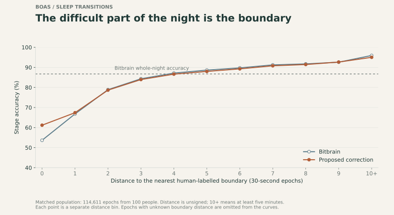
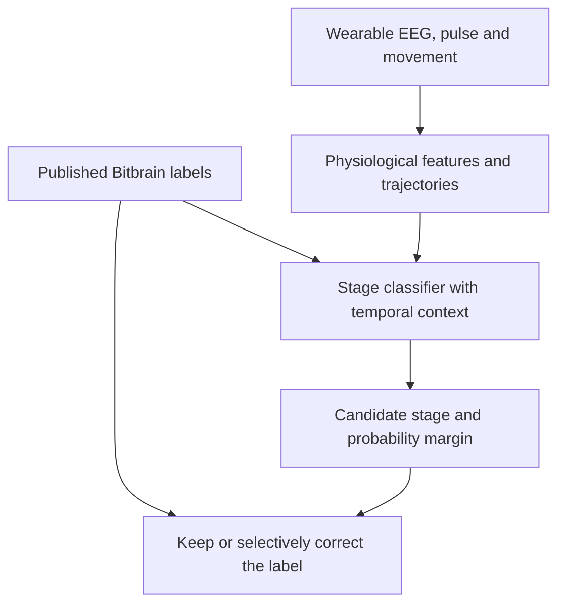
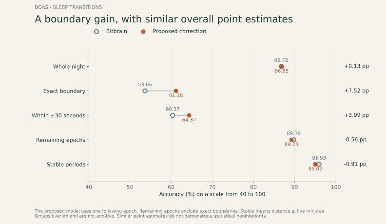
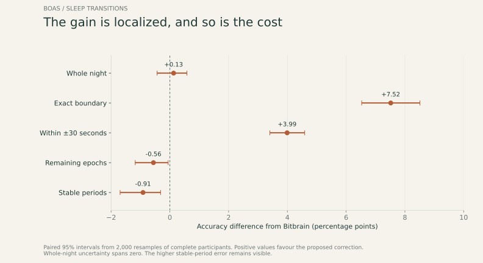
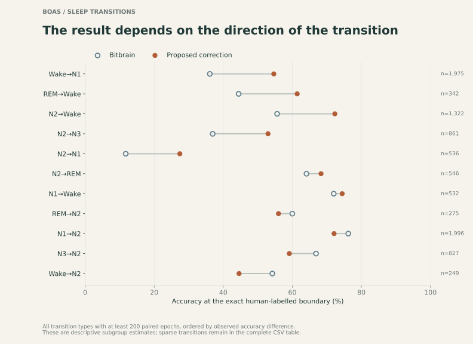
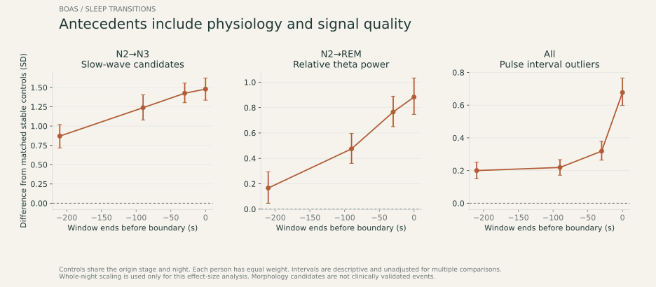
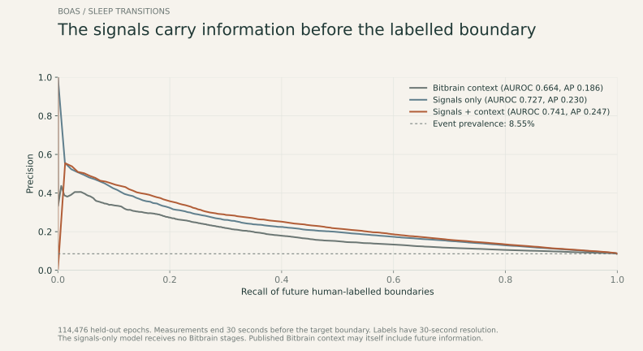

# BOAS Sleep Transition Predictor

Physiological dynamics for the difficult moments in wearable sleep staging.

Sleep-stage classifiers can perform well across a full night while struggling at the moment a person moves from one stage to another. The aim of this project is to understand those boundaries and test whether EEG, pulse and movement dynamics can help correct the predictions made around them.

The proposed correction increases accuracy at the exact human-labelled boundary from 53.66% to 61.18%. Whole-night accuracy has a similar point estimate: 86.72% for Bitbrain and 86.85% after correction. There is a trade-off: accuracy decreases slightly outside those boundaries. The analysis makes that cost explicit rather than treating the global score as the whole result.

## 1. Bitbrain, BOAS and the starting point

[Bitbrain](https://www.bitbrain.com/) develops neurotechnology for recording and analysing human brain activity. Its [Bitbrain Open Access Sleep dataset](https://github.com/OpenNeuroDatasets/ds005555) provides simultaneous clinical polysomnography and wearable headband recordings from 128 nights. The snapshot used here contains 100 distinct participant identifiers. Some people contributed more than one night.

The headband records two frontal EEG channels, approximately AF7 and AF8, with optional optical pulse and six-axis movement signals. Three experts independently scored the clinical PSG. Agreement between at least two scorers defined the reference, with a fourth resolving three-way disagreements. The release also provides automatic labels for the headband and PSG.

The dataset's own description reports 86.71% agreement for the wearable model and 87.13% for its PSG counterpart. These are the published release statistics. Our paired experiment has a slightly different eligible population, so its wearable baseline is 86.72%. A [related study by Bitbrain researchers](https://doi.org/10.1016/j.compbiomed.2026.111560) examines electrode configuration, temporal context and real-time sleep scoring on other open datasets. Its experiments should not be confused with this BOAS comparison.

Every sleep label represents a 30-second epoch: Wake, N1, N2, N3 or REM. Here, *accuracy* means the proportion of epochs matching the human consensus. It is distinct from the precision of a transition detector.

## 2. Identifying the problem

A human-labelled boundary is the first valid epoch whose stage differs from the preceding, contiguous epoch. On the matched evaluation population, Bitbrain agrees with the reference on 86.72% of all epochs, but only 53.66% of the 9,737 boundary epochs. In stable periods at least five minutes from a boundary, agreement reaches 95.93%.

The question is therefore specific: can we improve classification at human-defined transitions while retaining useful performance during the rest of the night? The consensus label is an operational reference with 30-second resolution. It does not locate the biological transition to the nearest second.



## 3. Literature as a starting hypothesis

The review suggested looking at trajectories and short events, rather than relying only on average EEG power over an entire epoch.

| Evidence | Working hypothesis | What the code measures |
|---|---|---|
| Delta and sigma dynamics have predicted NREM→REM transitions minutes in advance in longitudinal EEG [Leguia et al.](https://pubmed.ncbi.nlm.nih.gov/41426434/) | The relationship between bands may carry information beyond the current stage | Delta/sigma ratio, spectral slopes within the epoch, changes over 30–240 seconds |
| Alpha/theta evolution is associated with the sleep-onset process [2026 study](https://doi.org/10.1088/1741-2552/ae9226) | A changing ratio may help characterise the approach to light sleep | Alpha/theta ratio, its within-epoch trajectory and its recent history |
| Slow waves and spindles evolve differently during the descent into sleep [Siclari et al.](https://doi.org/10.5665/sleep.4070) | Event-like structure may add information lost in average band power | Slow-wave morphology candidates, sigma-envelope bursts and absolute/relative band power |
| Cardiac changes can precede cortical arousals and scored REM [Bonnet & Arand](https://pubmed.ncbi.nlm.nih.gov/9191582/) | Autonomic dynamics may contribute complementary antecedent information | Pulse rate, acceleration, interval variability and a trailing 90-second window |
| High-frequency spectral slope varies with arousal, but muscle and reference effects matter [Lendner et al.](https://doi.org/10.7554/eLife.55092) | Activation and signal quality need to be measured together | Descriptive 30–45 Hz slope, high-frequency power, amplitude, flatness and movement |

These are hypotheses to test in frontal wearable signals. They are not universal transition rules. Pulse variability is not automatically equivalent to ECG-based heart-rate variability, and the morphology candidates have not been validated as clinical spindle or slow-wave annotations. The [evidence notes](docs/evidence.md) explain these distinctions and the sources in more detail.

## 4. What is implemented

Bitbrain's released labels remain the starting prediction. The project adds a selective correction layer. It does not change Bitbrain's network, retrain its private weights or use its unavailable class probabilities.



The EEG epoch is divided into six five-second windows. Their spectra, amplitude and morphology summaries describe how the signal evolves. Pulse processing rejects implausible intervals and calculates successive differences only across originally consecutive valid intervals. Movement and signal-quality indicators are retained alongside the physiological measures.

A histogram gradient-boosted classifier learns the human-consensus stage from these signals and the recent Bitbrain labels. Square-root class weighting gives less frequent stages more influence. Exact boundaries receive twice the training weight. A label changes only when the model's preferred stage exceeds the original label by a selected probability margin. Human stages and boundary locations are training targets and evaluation variables, never model inputs.

The main comparison is offline: it also uses the following epoch. An additional current/past-input variant and a context-only ablation are included. A separate forecasting experiment predicts a human-labelled boundary 30 seconds after the input window ends, with an independent signals-only model to avoid relying on Bitbrain stages for that prediction.

Five outer folds keep all nights from the same person together. Three inner grouped folds select the correction margin, prioritising boundary accuracy under explicit global and stable-period constraints. Those constraints guide selection. They do not guarantee the same behaviour in outer test participants. See [methods and code map](docs/methods.md).

## 5. Results

All staging comparisons use the same 114,611 paired epochs from 100 people.

| Evaluation region | Bitbrain accuracy | Proposed accuracy | Difference |
|---|---:|---:|---:|
| Whole night | 86.72% | 86.85% | +0.13 pp |
| Exact human-labelled boundary | 53.66% | 61.18% | +7.52 pp |
| Within ±30 seconds of a boundary | 60.37% | 64.37% | +3.99 pp |
| Remaining epochs, excluding exact boundaries | 89.79% | 89.23% | −0.56 pp |
| Stable periods, at least five minutes away | 95.93% | 95.02% | −0.91 pp |

Regions overlap and are not additive. The difference in the near-boundary row is calculated before rounding the two accuracies.



The boundary gain corresponds to a 16.2% relative reduction in boundary error. Its paired 95% participant-bootstrap interval is +6.53 to +8.51 accuracy points. The model changes 4.93% of labels and increases macro-F1 from 0.719 to 0.744.

There are 732 additional correctly classified boundary epochs, partly offset by 586 fewer correct labels outside the exact boundaries. The net result is 146 additional correct epochs across the whole matched population. This explains why the boundary improvement is substantial while the global point estimate changes very little.



The whole-night difference has a 95% interval of −0.43 to +0.58 points. Similar point estimates therefore do not establish statistical noninferiority. A more conservative correction policy reduces the stable-period cost but also reduces boundary accuracy to 57.78%. It is a secondary, post-hoc sensitivity analysis.

Performance also depends on direction. Wake→N1, N2→N3 and several transitions towards wakefulness improve. N3→N2 and N1→N2 worsen. The complete [transition table](results/directed_transitions.csv) includes the unfavourable and sparse cases.



### Antecedent physiology and prediction

Before N2→N3, slow-wave candidates and delta/sigma increase. Before N2→REM, theta increases while delta decreases. Pulse-quality deterioration and movement also precede some boundaries, which means predictive information can contain both physiological activation and sensor contamination.



In the separate 30-second-ahead experiment, adding signals improves AUROC from 0.664 for context alone to 0.741. The signals-only model reaches 0.727, with average precision 0.230 against an event prevalence of 8.55%. It receives no Bitbrain stages. These metrics describe forecasting, not five-class stage accuracy.



## Conclusions and scope

The results support a focused contribution: physiological dynamics help anticipate labelled transitions and improve classification at those boundaries within BOAS. The remaining-epoch cost makes it important to judge the complete night, not only the primary endpoint.

This is exploratory development on BOAS, not an external validation of a commercial product. The dataset informed feature and model choices. Bitbrain's released labels were produced by its own cross-validation, whose splits cannot be fully aligned with ours. Strict independence of the combined system is therefore not established. A frozen classifier and an external simultaneous PSG/headband cohort are needed before claiming a product-level improvement. Published Bitbrain context may itself use future information, so the added current/past features do not establish end-to-end real-time operation.

## Explore and reproduce

Use Python 3.12. The compact labels, held-out predictions and result tables are included. Raw EDF files, extracted feature caches and trained model files are excluded from Git.

```bash
python -m venv .venv
# Activate .venv, then:
python -m pip install -e ".[notebook,dev]"
python scripts/validate_results.py
python scripts/make_figures.py
python -m pytest
```

Open [the exploratory notebook](notebooks/BOAS_transition_analysis.ipynb) in VS Code and select the `.venv` kernel. Its default exploration uses the included results. Signal-level exploration becomes available after extracting features.

To rebuild from the pinned public signals and retrain:

```bash
python scripts/download_data.py
python scripts/extract_features.py --workers 4
python scripts/train.py --forecast
```

The EDF download is 13.44 GB and every file is checked against the source SHA-256. Extraction and nested training require more time than browsing the notebook. [Reproducibility instructions](docs/reproducibility.md) cover the data, environment, evaluation and optional cached-feature route.

## Attribution

Author: Miguel Omar Belhouk Herrero. This is an independent analysis, with no implied affiliation with or endorsement by Bitbrain. AI assistance was used for coding and editing. Reported values were checked against saved held-out predictions.

Code is released under the [MIT licence](LICENSE). BOAS data remain under their upstream CC0 licence. Please cite the [dataset](https://doi.org/10.82901/nemar.on005555) and the primary studies used for the hypotheses. The [references](docs/evidence.md) and [machine-readable provenance](data/metadata/provenance.json) are included.
